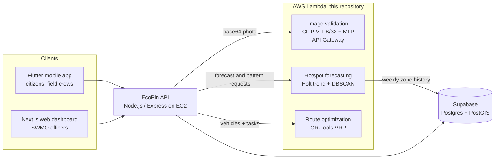
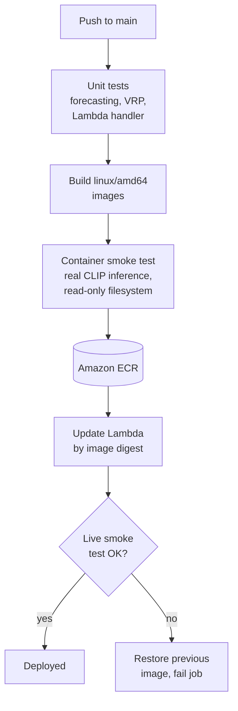

# EcoPin ML Services

**The Python services behind EcoPin's automation: an image validator that screens citizen photo evidence, a hotspot forecaster that projects where reports will appear, and an OR-Tools route solver that plans cleanup-crew routes.**


EcoPin is our BSIT capstone project at Pamantasan ng Lungsod ng Pasig, built for the Pasig City Solid Waste Management Office (SWMO). Residents report environmental problems from the mobile app. These services decide whether the photo evidence is usable, forecast future hotspots, and plan crew routes. Each one runs as a container image on AWS Lambda and is called by the [EcoPin API](https://github.com/klacom/ecopin_backend_node).

> **Image validator results** (production model, held-out test set of 180 images):
> **92.8% accuracy · 0.918 macro-F1** · 90.6% accuracy / 0.896 macro-F1 on validation.
> Source: [`image_validation/artifacts/exp03_2_clip_refined/`](image_validation/artifacts/exp03_2_clip_refined)

<!-- Screenshot placeholder: add a GIF of a photo being classified (or the forecast map on the dashboard) at docs/images/demo.gif, then uncomment:

-->

## The EcoPin repositories

| Repository | What it is |
| --- | --- |
| [ecopin_backend_node](https://github.com/klacom/ecopin_backend_node) | Node.js/Express REST API, background jobs, SQL migrations |
| [ecopin_app](https://github.com/klacom/ecopin_app) | Flutter mobile app for citizens and field crews |
| **[ecopin_ml_models](https://github.com/klacom/ecopin_ml_models)** (you are here) | Python services: image validation, hotspot forecasting, route optimization |
| [ecopin-web](https://github.com/baldopadua/ecopin-web) | Next.js web dashboard for SWMO officers and administrators |

## Features

### 1. Image validation (`image_validation/`)

Decides whether a citizen's photo is usable evidence of an environmental problem.

- **Model:** frozen **CLIP ViT-B/32** image encoder → 512-d embedding → a small regularized MLP (512 → 128 → 32 → 1, dropout 0.3, ~70K trainable parameters) that outputs P(valid).
- **Three-way decision:** `APPROVED` at P(valid) ≥ 0.50, otherwise `REJECTED`. Anything in the uncertain band 0.35–0.65 goes to `MANUAL_REVIEW` for an officer. All thresholds are configurable.
- **Issue category:** for non-rejected images, zero-shot CLIP picks the issue type (waste, flooding, pollution, illegal logging, other).
- **Serving:** a plain HTTP server for local use (`POST /classify`, `GET /health`) and a native Lambda handler behind API Gateway that accepts base64 JSON.

### 2. Hotspot forecasting (`hotspot_forecasting/`)

Projects how many reports each zone of Pasig is likely to receive.

- Zones are 122 **H3 resolution-8 hexagons** covering the Pasig study area, or barangays.
- Uses 52 complete weeks of validated report history per zone, read from Supabase.
- A **damped additive Holt trend** model gives 7, 30, and 90-day projections with approximate 95% prediction intervals. Sparse zones fall back to a pooled Gamma-Poisson estimate.
- Each zone gets a risk level: high means more than 15 predicted reports or more than 40% growth.
- **Historical pattern analysis** (`POST /patterns/analyze`) runs haversine DBSCAN over past 7/30/90-day windows to find recurring hotspots. It is protected by a server-only bearer token and bounded to one analysis at a time and 5,000 points.

### 3. Route optimization (`vrp_service/`)

Plans which crew vehicle visits which cleanup tasks, in what order.

- A **vehicle routing problem** solved with Google OR-Tools (`POST /solve_vrp`).
- Constraints: crew shifts and breaks, task time windows, per-vehicle task limits, volume (m³) and weight (kg) capacity, allowed task types, and crew certifications.
- Uses a path-cheapest-arc initial solution and guided local search, with a hard time limit. Tasks that can't fit are returned as dropped instead of failing the whole plan.

### Supporting tools

- `image_validation/dataset_downloader/`: rate-limited image collector (Flickr, Wikimedia) used to build the training set.
- `image_validation/training/`: training scripts for every experiment below.
- `scripts/`: Lambda deploy and rollback, container smoke tests, and a desktop app for labeling severity pilot images.
- `route_and_task_optimization/`: an earlier FastAPI prototype for task generation. It is not deployed.

## How the image model got to 92.8%

The first approach didn't work well enough, so we changed it. Every run's config, per-epoch metrics, and predictions are committed under `image_validation/artifacts/` and `final_1000_dataset/experiments/`.

| Stage | Approach | Task | Best result |
| --- | --- | --- | --- |
| Exp 2–16 | EfficientNet-B0 fine-tuning (ImageNet weights), ~350 images | 4 classes: waste, flooding, pollution, non-environmental | 69.8% val accuracy, 0.674 macro-F1 (Exp 8, 53 val images) |
| Exp 01–05 | EfficientNet-B0 on a balanced 1,000-image dataset (800/100/100), label cleanup | same 4 classes | 74% val / 62% test accuracy (Exp 02); best test 64% accuracy, 0.620 macro-F1 (Exp 05) |
| Exp 3.1 | Frozen CLIP ViT-B/32 embeddings + linear / MLP heads | binary: valid vs. invalid evidence | 91.1% test accuracy, 0.901 macro-F1 |
| **Exp 3.2 (production)** | Same pipeline on refined embeddings, regularized MLP | binary | **92.8% test accuracy, 0.918 macro-F1** |

Two changes made the difference. The backend only needs to know whether a photo is usable evidence, not its exact category, so a **binary task** fits better than four classes. And with a dataset this small, a **frozen general-purpose encoder** (CLIP) generalized far better than fine-tuning a CNN.

**Exp 3.2 test confusion matrix** (threshold 0.50, before the manual-review band):

| | Predicted invalid | Predicted valid |
| --- | ---: | ---: |
| **Actually invalid** (60) | 53 | 7 |
| **Actually valid** (120) | 6 | 114 |

Per class: invalid precision 0.90 / recall 0.88; valid precision 0.94 / recall 0.95. The 0.35–0.65 review band sends borderline photos to a human, which reduces wrong automatic decisions further. These numbers come from a held-out test split. They are not measurements on live traffic.

## Tech stack

| Area | Tools |
| --- | --- |
| ML | PyTorch, OpenAI CLIP (ViT-B/32), timm (EfficientNet-B0 experiments), scikit-learn |
| Forecasting | statsmodels (damped Holt), SciPy (negative-binomial intervals), NumPy, scikit-learn DBSCAN, H3 zone grid stored in PostGIS |
| Optimization | Google OR-Tools constraint solver, Flask, gunicorn |
| Data | Supabase (Postgres + PostGIS) via `supabase-py` |
| Deployment | Docker, AWS Lambda (container images + Lambda Web Adapter), Amazon ECR, API Gateway, GitHub Actions with OIDC |

## Architecture



The image validator and VRP solver are stateless; they get everything they need in the request. Only the forecaster reads the database, through a validated-reports-only view.

### Deployment pipeline



The three services deploy independently. GitHub Actions authenticates to AWS with OIDC, so no AWS keys are stored in GitHub. See [DEPLOY.md](DEPLOY.md) for the full runbook and manual rollback.

## My role

EcoPin was built by a two-person team. I wrote nearly all of this repository (41 of 44 commits). My work here:

- **Image validation:** ran the EfficientNet-B0 experiments, decided to move to frozen CLIP embeddings, trained and evaluated the Exp 3.x classifiers, and chose the thresholds and manual-review band.
- **Dataset:** built the image downloader and audited labels (leakage checks, relabel manifests, a protected test set).
- **Forecasting and routing:** wrote the forward zone forecaster, historical pattern analysis, and the OR-Tools VRP solver.
- **MLOps:** containerized all three services for Lambda and built the GitHub Actions pipeline with smoke tests and automatic rollback.

My teammate **Charles Jeramy De Padua** built the first DBSCAN hotspot clustering and heatmap generation, and an early zero-shot severity estimator.

## Getting started

Each service runs on its own. Python 3.11+ is recommended. The production images use 3.11 (forecasting, VRP) and 3.12 (image validation).

```bash
git clone https://github.com/klacom/ecopin_ml_models.git
cd ecopin_ml_models
python -m venv .venv
source .venv/bin/activate        # Windows: .venv\Scripts\activate
```

### Image validator (port 8001)

The trained checkpoint is included. The CLIP weights download on first run.

```bash
pip install torch torchvision --index-url https://download.pytorch.org/whl/cpu
pip install setuptools wheel
pip install --no-build-isolation -r image_validation/requirements-lambda.txt
cd image_validation
EXP32_DEVICE=cpu python inference_service_exp32.py
```

```bash
curl http://127.0.0.1:8001/health
curl -X POST -H "Content-Type: image/jpeg" --data-binary @photo.jpg http://127.0.0.1:8001/classify
```

To use it from the backend, set `CLASSIFIER_SERVICE_URL=http://127.0.0.1:8001` in the backend's `.env`.

### Hotspot forecaster (port 8002)

It needs a Supabase database with the EcoPin schema (see the [backend migrations](https://github.com/klacom/ecopin_backend_node/tree/master/migrations)).

```bash
pip install -r hotspot_forecasting/requirements.txt
cp hotspot_forecasting/.env.example hotspot_forecasting/.env   # fill in your values
cd hotspot_forecasting
python inference_service.py
```

### VRP solver (port 8003)

```bash
pip install -r vrp_service/requirements.txt
cd vrp_service
python vrp_solver.py
```

### Tests

```bash
python -m unittest discover -s hotspot_forecasting -p "test_*.py"
python -m unittest discover -s vrp_service -p "test_*.py"
python -m unittest discover -s image_validation -p test_lambda_handler.py
python -m unittest discover -s scripts -p "test_*.py"
```

### Environment variables

Key names only. Never commit real values.

| Service | Keys |
| --- | --- |
| Image validator | `EXP32_CHECKPOINT_PATH`, `EXP32_CLIP_MODEL`, `EXP32_THRESHOLD`, `EXP32_REVIEW_LO`, `EXP32_REVIEW_HI`, `EXP32_HOST`, `EXP32_PORT`, `EXP32_DEVICE`, `MAX_BODY_BYTES` |
| Hotspot forecaster | `SUPABASE_URL`, `SUPABASE_SECRET_KEY`, `SPATIAL_ANALYTICS_TOKEN`, `HOST`, `PORT`, `DBSCAN_EPS_METERS`, `DBSCAN_MIN_SAMPLES` |
| VRP solver | none (the port is set by the container) |

`image_validation/.env.example` documents the earlier EfficientNet-B0 service (`inference_service.py`), which is no longer deployed.

## Project structure

```text
ecopin_ml_models/
├── image_validation/
│   ├── inference_service_exp32.py   # production classifier (HTTP server)
│   ├── lambda_handler.py            # AWS Lambda entry point
│   ├── artifacts/                   # every experiment's config, metrics, checkpoints
│   ├── training/                    # training scripts
│   ├── dataset_downloader/          # dataset collection tool
│   └── Dockerfile
├── hotspot_forecasting/
│   ├── inference_service.py         # HTTP API
│   ├── zone_forecaster.py           # Holt-trend zone projections
│   ├── historical_patterns.py       # DBSCAN pattern analysis
│   └── Dockerfile
├── vrp_service/
│   ├── vrp_solver.py                # OR-Tools VRP API
│   └── Dockerfile
├── final_1000_dataset/experiments/  # EfficientNet-B0 runs on the 1,000-image set
├── route_and_task_optimization/     # prototype (not deployed)
├── scripts/                         # deploy, smoke tests, labeling tools
├── DEPLOY.md
└── .github/workflows/deploy.yml
```

The image dataset itself is not in this repository.

## Team and credits

- **Klarenz Cobie O. Manrique** ([@klacom](https://github.com/klacom)): ML services, backend, mobile app, DevOps
- **Charles Jeramy C. De Padua** ([@baldopadua](https://github.com/baldopadua)): web dashboard, early hotspot clustering, backend
- **Adviser:** Greta M. Rosario, DIT

Capstone project, *EcoPin A.I.: Crowdsourced Geospatial Platform for Transparent Environmental Reporting and Rapid Institutional Detection for the Pasig City Solid Waste Management Office*. BS Information Technology, College of Computer Studies, Pamantasan ng Lungsod ng Pasig.

## Related repositories

- [klacom/ecopin_backend_node](https://github.com/klacom/ecopin_backend_node): REST API and background jobs
- [klacom/ecopin_app](https://github.com/klacom/ecopin_app): Flutter mobile app
- [baldopadua/ecopin-web](https://github.com/baldopadua/ecopin-web): web dashboard ([live](https://ecopin-web.vercel.app))
